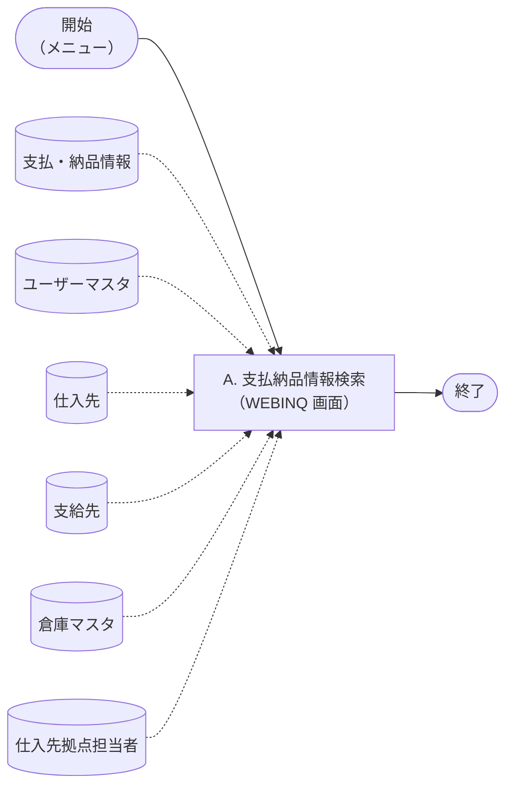

# OUM AN.100 機能設計書　支払納品情報

**トヨタ自動車株式会社　MAPS再構築プロジェクト**


## 支払納品情報

### 序説

本文書は、以下の関連文書で定義された機能を記述対象とする。

| 関連文書 | 補足 |
| --- | --- |
| C7_RD_SO_MC030_630_ソリューション定義(支払納品情報検索) | 支払納品情報ＣＳＶファイル作成機能部分を本文書の対象とする。 |
| C7_RD_SO_MC100_610_支払納品情報 | なし |

### 機能概要

このモジュールは以下の業務上の要件を実現する。

- 支給先／仕入先が自社分の支払納品情報を一括ダウンロードする。
- 調達部が支払納品情報を一括ダウンロードする。

### 機能要件

- 売買区分や仕入先、Ｙ品番、手配連番、支給先などの条件により支払や納品情報を検索できること。（鋼材も含む）【35-③-1】

### 前提条件

本機能は、以下の条件が満たされていることを前提に設計する。

- 日々作成される納品書データが調達部／仕入先／支給先にて確認できる。
- 仕入先（支給先）担当者毎に EBS ユーザーが登録され、仕入先（支給先）情報と紐づいている必要がある。
  （上記前提により、仕入先（支給先）担当者は自社の対象データのみを処理対象とすることが可能）
- 仕入先（支給先）向けに EBS 公開可能な環境が用意されている必要がある。

### 機能プロセス・フロー

#### 支払納品情報　機能プロセスフロー



原文の図の構成（テキスト表現）：

- 開始（メニュー）→ **A. 支払納品情報検索**（WEBINQ 画面）→ 終了
- 画面の下部に、点線で以下の参照先（データ／マスタ）が接続される
  - 支払・納品情報／ユーザーマスタ／仕入先／支給先／倉庫マスタ／仕入先拠点担当者

### モジュール一覧

本機能は、以下のモジュールで構成する。

| No. | モジュール名 | 種別 | 説明 |
| --- | --- | --- | --- |
| A | 支払納品情報検索 | WEBINQ | 支払・納品情報を参照、ダウンロードする。 |

---

## A. 支払納品情報検索　WEBINQ

### 概要

本モジュールは、以下の業務上の要件を実現するための機能を提供する。

- 調達部／仕入先／支給先／原価改善室（及び各カンパニー分室）が支払納品情報を一括ダウンロードする。
- 仕入先が使用する場合：ログインしている仕入先ユーザに紐付く仕入先データを対象とする。
- 支給先が使用する場合：ログインしている支給先ユーザに紐付く支給先データを対象とする。
- 調達部が使用する場合：全データを対象とする。
- 原価改善室（及び各カンパニー分室）が使用する場合：全データを対象とする。

### 前提条件

本モジュールは、以下の条件が満たされていることを前提に設計する。

- 検索対象となるデータは、納品書データ作成バッチ処理によって作成されるものとする。

### 照会画面の名称

本モジュールで定義する照会画面の名称は以下の通りである。

| 照会画面の名称 |  |
| --- | --- |
| 支払納品情報検索 | XXSO_SO_610A_WI |

### テーブル情報

本モジュールでは、以下のテーブル（ビュー）を使用するものとする。

| ビジネス・オブジェクト | 論理テーブル名 | 物理テーブル名 |
| --- | --- | --- |
| 支払・納品情報 | 支払・納品情報検索用データ | XXSO_PAYMENT_DELIVERYS |
| ユーザーマスタ | ユーザーマスタ | FND_USER |
| - | FND参照 | FND_LOOKUP_VALUES_VL |
| 支給先 | 支給先テーブル | XXSO_FURNISHED_PLACES |
| 仕入先 | 仕入先付加情報 | XXPO_SUPPLIERS_INFO |
| 仕入先 | 仕入先拠点担当者 | XXPO_SUPPLIERS_RP |
| 倉庫マスタ | 保管場所 | MTL_SECONDARY_INVENTORIES |
| 支給品 | 支給品マスタ | XXIN_SUPPLY_ITEM_MST |
| - | 持込先コード参照 | XXSO_BROUGHT_IN_LOOKUP |
| - | 従業員情報取得ビュー | XXSO_PER_ALL_PEOPLE_F_V |
| - | 仕入先情報取得ビュー(無効含む) | XXSO_SUPPLIER_ALL_V |
| - | 支給先情報取得ビュー(無効含む) | XXSO_SUPPLY_DEST_ALL_V |
| - | 支払納品情報サマリ | XXSO_PAYMENT_DELIVERYS_SUM |

### WEBINQ 項目

| ID | 項目名 | グループ | 抽出条件 | 必須 | 項目タイプ | 値リスト | 摘要 | デフォルト値 | 小計キー | 小計対象 | 導出元論理テーブル名 | 出力論理テーブル列名 | 備考 |
| --- | --- | --- | --- | --- | --- | --- | --- | --- | --- | --- | --- | --- | --- |
| 1 | Y品番 | 支払納品情報検索 | ○ | - | テキスト | - | - | - | - | - | 支払・納品情報検索用データ | 支払・納品情報検索用データ.Y品番 | - |
| 2 | 品名 | 支払納品情報検索 | - | - | テキスト | - | - | - | - | - | 支払・納品情報検索用データ | 支払・納品情報検索用データ.品名 | - |
| 3 | 仕入先コード | 支払納品情報検索 | ○ | - | テキスト | ○ | - | - | - | - | 支払・納品情報検索用データ | 支払・納品情報検索用データ.仕入先コード | - |
| 4 | 仕入先名称 | 支払納品情報検索 | - | - | テキスト | - | - | - | - | - | 支払・納品情報検索用データ | 支払・納品情報検索用データ.仕入先名称 | - |
| 5 | 売買区分 | 支払納品情報検索 | ○ | - | ポップリスト | - | - | - | - | - | 支払・納品情報検索用データ | 支払・納品情報検索用データ.売買区分 | 'K':買掛<br>'U':売掛 |
| 6 | 売買区分名称 | 支払納品情報検索 | - | - | テキスト | - | - | - | - | - | 支払・納品情報検索用データ、FND参照 | FND参照.内容 | - |
| 7 | 持込先コード | 支払納品情報検索 | ○ | - | テキスト | ○ | - | - | - | - | 支払・納品情報検索用データ | 支払・納品情報検索用データ.持込先コード | ◆支払・納品情報検索用データ．売買区分<br>＝ 'U'：売掛の場合、<br>ブランクを表示<br>◆上記以外の場合、<br>持込先コードを表示 |
| 8 | 持込先名称 | 支払納品情報検索 | - | - | テキスト | - | - | - | - | - | 支払・納品情報検索用データ、FND参照 | 支払・納品情報検索用データ.持込先名称、FND参照.ATTRIBUTE4（納入場所名称） | ◆支払・納品情報検索用データ．売買区分<br>＝ 'U'：売掛の場合、<br>ブランクを表示<br>◆上記以外の場合、<br>持込先名称を表示<br>※持込先名称がブランクの場合にATTRIBUTE4（納入場所名称）を表示する。 |
| 9 | 持込先工場区分 | 支払納品情報検索 | - | - | テキスト | - | - | - | - | - | 支払・納品情報検索用データ | 支払・納品情報検索用データ.持込先工場区分 | ◆支払・納品情報検索用データ．売買区分<br>＝ 'U'：売掛の場合、<br>ブランクを表示<br>◆上記以外の場合、<br>持込先工場区分を表示 |
| 10 | メーカーコード | 支払納品情報検索 | - | - | テキスト | - | - | - | - | - | 支払・納品情報検索用データ | 支払・納品情報検索用データ.メーカーコード | - |
| 11 | メーカー名称 | 支払納品情報検索 | - | - | テキスト | - | - | - | - | - | 支払・納品情報検索用データ | 支払・納品情報検索用データ.メーカー名称 | - |
| 12 | 納入数量 | 支払納品情報検索 | - | - | 金額 | - | - | - | - | - | 支払・納品情報検索用データ | 支払・納品情報検索用データ.納入数量 | - |
| 13 | 納入年月日カラ | 支払納品情報検索 | ○ | ○ | 日付 | - | - | - | - | - | 支払・納品情報検索用データ | 支払・納品情報検索用データ.納入年月日 | 納入年月日カラ<=支払・納品情報検索用データ.納入年月日 |
| 14 | 納入年月日マデ | 支払納品情報検索 | ○ | ○ | 日付 | - | - | - | - | - | 支払・納品情報検索用データ | 支払・納品情報検索用データ.納入年月日 | 納入年月日マデ>=支払・納品情報検索用データ.納入年月日 |
| 15 | 納入番号 | 支払納品情報検索 | ○ | - | テキスト | - | - | - | - | - | 支払・納品情報検索用データ | 支払・納品情報検索用データ.納入番号 | - |
| 16 | 処理年月日 | 支払納品情報検索 | - | - | 日付 | - | - | - | - | - | 支払・納品情報検索用データ | 支払・納品情報検索用データ.処理年月日 | - |
| 17 | ステータス | 支払納品情報検索 | ○ | ○ | ポップリスト | - | - | - | - | - | 支払・納品情報検索用データ | 支払・納品情報検索用データ.ステータス | '1':確定済<br>'2':未処理<br>'3':単価未決<br>◆修理可否が「2：不可」 かつ 購入・支給単価が0 かつ ステータスが「1：確定済」<br>、「2：未処理」の場合、「キャンセル（分解費無）」を表示 |
| 18 | ステータス名称 | 支払納品情報検索 | - | - | テキスト | - | - | - | - | - | 支払・納品情報検索用データ、FND参照 | FND参照.内容 | - |
| 19 | 期区分 | 支払納品情報検索 | - | - | テキスト | - | - | - | - | - | 支払・納品情報検索用データ | 支払・納品情報検索用データ.期区分 | - |
| 20 | 調達係コード | 支払納品情報検索 | ○ | - | テキスト | ○ | - | - | - | - | 支払・納品情報検索用データ | 支払・納品情報検索用データ.調達係コード | - |
| 21 | 調達担当コード | 支払納品情報検索 | ○ | - | テキスト | ○ | - | - | - | - | 支払・納品情報検索用データ | 支払・納品情報検索用データ.調達担当コード | - |
| 22 | 下請法対象区分 | 支払納品情報検索 | - | - | テキスト | - | - | - | - | - | 支払・納品情報検索用データ | 支払・納品情報検索用データ.下請法対象区分 | '1':対象 の場合、「* 対象」を表示<br>'1':対象 以外の場合、ブランク表示 |
| 24 | スペック | 支払納品情報検索 | - | - | テキスト | - | - | - | - | - | 支払・納品情報検索用データ | 支払・納品情報検索用データ.スペック | - |
| 25 | ツールNo | 支払納品情報検索 | - | - | テキスト | - | - | - | - | - | 支払・納品情報検索用データ | 支払・納品情報検索用データ.ツールNo | - |
| 26 | 購入・支給単価 | 支払納品情報検索 | - | - | 金額 | - | - | - | - | - | 支払・納品情報検索用データ | 支払・納品情報検索用データ.購入・支給単価 | 1.修理可否が「2：不可」<br>かつ、購入・支給単価が０の場合、<br>ブランクを表示する。<br>2.経理連携済の場合、<br>購入・支給単価を表示する。<br>3.上記以外（経理連携前）の場合、<br>ブランクを表示する。 |
| 27 | 購入・支給金額 | 支払納品情報検索 | - | - | 金額 | - | - | - | - | - | 支払・納品情報検索用データ | 支払・納品情報検索用データ.購入・支給金額 | 1.修理可否が「2：不可」<br>かつ、購入・支給単価が０の場合、<br>ブランクを表示する。<br>2.経理連携済の場合、<br>購入・支給金額を表示する。<br>3.上記以外（経理連携前）の場合、<br>ブランクを表示する。 |
| 28 | 管理番号 | 支払納品情報検索 | - | - | テキスト | - | - | - | - | - | 支払・納品情報検索用データ | 支払・納品情報検索用データ.管理番号 | - |
| 29 | 手配連番 | 支払納品情報検索 | ○ | - | テキスト | - | - | - | - | - | 支払・納品情報検索用データ | 支払・納品情報検索用データ.手配連番 | - |
| 30 | 計上年月 | 支払納品情報検索 | - | - | テキスト | - | - | - | - | - | 支払・納品情報検索用データ | 支払・納品情報検索用データ.計上年月 | - |
| 31 | 前後半区分 | 支払納品情報検索 | - | - | テキスト | - | - | - | - | - | 支払・納品情報検索用データ | 支払・納品情報検索用データ.前後半区分 | '1':前半<br>'2':後半 |
| 32 | 前後半区分名称 | 支払納品情報検索 | - | - | テキスト | - | - | - | - | - | 支払・納品情報検索用データ | FND参照.内容 | - |
| 33 | 複社発注区分 | 支払納品情報検索 | ○ | - | テキスト | 〇 | - | - | - | - | 支払・納品情報検索用データ | ※調達部担当者の時<br>支払・納品情報検索用データ.複社発注区分<br>※仕入先・支給先担当者の時<br>⇒ブランク | '0'：１社<br>'1'：部署割<br>'2'：シェア割<br>'3'：工場割 |
| 34 | 複社発注区分名称 | 支払納品情報検索 | - | - | テキスト | - | - | - | - | - | 支払・納品情報検索用データ、FND参照 | ※調達部担当者<br>⇒FND参照.摘要<br>※仕入先・支給先担当者<br>⇒ブランク | - |
| 35 | 更新者 | 支払納品情報検索 | - | - | テキスト | - | - | - | - | - | 支払・納品情報検索用データ<br>ユーザーマスタ<br>従業員マスタ<br>FND参照<br>仕入先付加情報 | ※調達部担当者<br>⇒FND参照.内容(部署名）＋全角スペース<br>1文字＋ 従業員マスタ.従業員名<br>※仕入先・支給先担当者<br>⇒仕入先付加情報.仕入先コード＋全角スペース1文字＋仕入先付加情報.漢字仕入先名称 | 共通関数<br>XXSO_LOV_CARTRIDGE_PKG.get_updater_info<br>を使用 |
| 36 | 更新年月日 | 支払納品情報検索 | - | - | 日付 | - | - | - | - | - | 支払・納品情報検索用データ | 支払・納品情報検索用データ.更新年月日 | - |
| 37 | 還元金単価 | 支払納品情報検索 | - | - | 金額 | - | - | - | - | - | 支払・納品情報検索用データ | 支払・納品情報検索用データ.還元金単価 | 1.修理可否が「2：不可」<br>かつ、購入・支給単価が０の場合、<br>ブランクを表示する。<br>2.経理連携済の場合、<br>還元金単価を表示する。<br>3.上記以外（経理連携前）の場合、<br>ブランクを表示する。 |
| 38 | 支払・支給単価 | 支払納品情報検索 | - | - | 金額 | - | - | - | - | - | 支払・納品情報検索用データ | 支払・納品情報検索用データ.支払・支給単価 | 1.修理可否が「2：不可」<br>かつ、購入・支給単価が０の場合、<br>ブランクを表示する。<br>2.経理連携済の場合、<br>支払・支給単価を表示する。<br>3.上記以外（経理連携前）の場合、<br>ブランクを表示する。 |
| 39 | 還元金金額 | 支払納品情報検索 | - | - | 金額 | - | - | - | - | - | 支払・納品情報検索用データ | 支払・納品情報検索用データ.還元金金額 | 1.修理可否が「2：不可」<br>かつ、購入・支給単価が０の場合、<br>ブランクを表示する。<br>2.経理連携済の場合、<br>還元金金額を表示する。<br>3.上記以外（経理連携前）の場合、<br>ブランクを表示する。 |
| 40 | 支払・支給金額 | 支払納品情報検索 | - | - | 金額 | - | - | - | - | - | 支払・納品情報検索用データ | 支払・納品情報検索用データ.支払・支給金額 | 1.修理可否が「2：不可」<br>かつ、購入・支給単価が０の場合、<br>ブランクを表示する。<br>2.経理連携済の場合、<br>支払・支給金額を表示する。<br>3.上記以外（経理連携前）の場合、<br>ブランクを表示する。 |
| 41 | 通貨コード | 支払納品情報検索 | - | - | テキスト | - | - | - | - | - | 支払・納品情報検索用データ | 支払・納品情報検索用データ.通貨コード | - |
| 42 | 支給係コード | 支払納品情報検索 | ○ | - | テキスト | ○ | - | - | - | - | 支払・納品情報検索用データ | 支払・納品情報検索用データ.支給係コード | ◆支払・納品情報検索用データ．売買区分<br>＝ 'K'：買掛の場合、<br>ブランクを表示<br>◆上記以外の場合、<br>支給係コードを表示 |
| 43 | 支給先コード | 支払納品情報検索 | ○ | - | テキスト | ○ | - | - | - | - | 支払・納品情報検索用データ | 支払・納品情報検索用データ.支給先コード | ◆支払・納品情報検索用データ．売買区分<br>＝ 'K'：買掛の場合、<br>ブランクを表示<br>◆上記以外の場合、<br>支給先コードを表示 |
| 44 | 支給先名称 | 支払納品情報検索 | - | - | テキスト | - | - | - | - | - | 支払・納品情報検索用データ | 支払・納品情報検索用データ.支給先名称 | ◆支払・納品情報検索用データ．売買区分<br>＝ 'K'：買掛の場合、<br>ブランクを表示<br>◆上記以外の場合、<br>支給先名称を表示 |
| 45 | 支給先工区 | 支払納品情報検索 | - | - | テキスト | - | - | - | - | - | 支払・納品情報検索用データ | 支払・納品情報検索用データ.支給先工区 | ◆支払・納品情報検索用データ．売買区分<br>＝ 'K'：買掛の場合、<br>ブランクを表示<br>◆上記以外の場合、<br>支給先工区を表示 |
| 46 | 倉庫コード | 支払納品情報検索 | ○ | - | テキスト | ○ | - | - | - | - | 支払・納品情報検索用データ | 支払・納品情報検索用データ.倉庫コード | - |
| 47 | 倉庫名称 | 支払納品情報検索 | - | - | テキスト | - | - | - | - | - | 支払・納品情報検索用データ、FND参照 | 支払・納品情報検索用データ.倉庫名称、FND参照.ATTRIBUTE4（納入場所名称） | 倉庫名称がブランクの場合にATTRIBUTE4（納入場所名称）を表示する。 |
| 48 | 倉庫工区 | 支払納品情報検索 | - | - | テキスト | - | - | - | - | - | 支払・納品情報検索用データ | 支払・納品情報検索用データ.倉庫工区 | - |
| 49 | 単価区分 | 支払納品情報検索 | - | - | テキスト | - | - | - | - | - | 支払・納品情報検索用データ | 支払・納品情報検索用データ.単価区分 | ◆支払・納品情報検索用データ.が以下条件に全て一致する場合<br>スポットを表示<br>＜条件＞<br>・作成日が移行データ(プロファイル.運用開始日より前)<br>・「鋼材」(Y品番頭2桁がY1、Y2、Y3)<br>・単価区分 = '1':継続<br>・売買区分 = 'K':買掛<br>・支払・納品情報検索用データ.メーカーコード = NULL<br>◆上記以外の場合<br>単価区分を表示 |
| 50 | 単価区分名称 | 支払納品情報検索 | - | - | テキスト | - | - | - | - | - | 支払・納品情報検索用データ、FND参照 | FND参照.内容 |  |
| 51 | 修理パターン | 支払納品情報検索 | - | - | テキスト | - | - | - | - | - | 支払・納品情報検索用データ | 支払・納品情報検索用データ.修理パータン | - |
| 52 | 修理パターン名称 | 支払納品情報検索 | - | - | テキスト | - | - | - | - | - | 支払・納品情報検索用データ、FND参照 | FND参照.内容 | - |
| 53 | 修理可否 | 支払納品情報検索 | - | - | テキスト | - | - | - | - | - | 支払・納品情報検索用データ | 支払・納品情報検索用データ.修理可否 | - |
| 54 | 修理可否名称 | 支払納品情報検索 | - | - | テキスト | - | - | - | - | - | 支払・納品情報検索用データ、FND参照 | FND参照.摘要 | - |
| 55 | 訂正前単価（購入・支給単価） | 支払納品情報検索 | - | - | 金額 | - | - | - | - | - | 支払・納品情報検索用データ | 支払・納品情報検索用データ.前回単価（購入・支給単価） | 1.修理可否が「2：不可」<br>かつ、購入・支給単価が０の場合、<br>ブランクを表示する。<br>2.経理連携済の場合、<br>訂正前単価（購入・支給単価）<br>を表示する。<br>3.上記以外（経理連携前）の場合、<br>ブランクを表示する。 |
| 56 | 訂正前単価（還元金単価） | 支払納品情報検索 | - | - | 金額 | - | - | - | - | - | 支払・納品情報検索用データ | 支払・納品情報検索用データ.前回単価（還元金単価） | 1.修理可否が「2：不可」<br>かつ、購入・支給単価が０の場合、<br>ブランクを表示する。<br>2.経理連携済の場合、<br>訂正前単価（還元金単価）<br>を表示する。<br>3.上記以外（経理連携前）の場合、<br>ブランクを表示する。 |
| 57 | 訂正前単価（支払・支給単価） | 支払納品情報検索 | - | - | 金額 | - | - | - | - | - | 支払・納品情報検索用データ | 支払・納品情報検索用データ.前回単価（支払・支給単価） | 1.修理可否が「2：不可」<br>かつ、購入・支給単価が０の場合、<br>ブランクを表示する。<br>2.経理連携済の場合、<br>訂正前単価（支払・支給単価）<br>を表示する。<br>3.上記以外（経理連携前）の場合、<br>ブランクを表示する。 |
| 58 | データ種別 | 支払納品情報検索 | - | - | テキスト | - | - | - | - | - | 支払・納品情報検索用データ、FND参照 | FND参照.内容 | - |
| 59 | 遡り訂正フラグ | 支払納品情報検索 | - | - | ポップリスト | - | - | - | - | - | 支払・納品情報検索用データ | 支払・納品情報検索用データ.遡り訂正フラグ | '０'：通常<br>''１'：遡り訂正 |
| 60 | 値決め集計区分 | 支払納品情報検索 | - | - | テキスト | - | - | - | - | - | 支払・納品情報検索用データ、FND参照 | FND参照.内容 | - |
| 61 | 発注日 | 支払納品情報検索 | - | - | 日付 | - | - | - | - | - | 支払・納品情報検索用データ | 支払・納品情報検索用データ．発注日 | - |

#### 結合条件

```text
-- 売買区分名称取得
FND参照.参照タイプ ＝ XXSO_BUYING_AND_SELLING_CLS：'売買区分'
支払・納品情報検索用データ.売買区分 ＝ FND参照.コード

-- ステータス名称取得
FND参照.参照タイプ ＝ XXSO_PAYMENT_DELIVERYS_STATUS：'支払・納品情報ステータス'
支払・納品情報検索用データ.ステータス ＝ FND参照.コード

-- 前後半区分名称取得
FND参照.参照タイプ ＝ XXSO_EARLY_AND_LATE_CLS：'前後半区分'
支払・納品情報検索用データ.前後半区分 ＝ FND参照.コード

-- 複社発注区分名称取得
FND参照.参照タイプ ＝ 'XXPO_MULTIPLE_COM_ODR_CLS'：'複社発注区分'
支払・納品情報検索用データ.複社発注区分 ＝ FND参照.コード

-- 更新者の部署名称取得
ユーザーマスタ.ユーザーID ＝ 支払・納品情報検索用データ.更新(ユーザー内部ID)
従業員マスタ.従業員ID ＝ ユーザーマスタ.個人ID
FND参照.参照タイプ ＝ XXCM_DEPARTMENT_MST：部署マスタ'
FND参照.コード ＝ 従業員マスタ.部署コード(頭2桁)

-- 更新者の従業員名称取得
ユーザーマスタ.ユーザーID ＝ 支払・納品情報検索用データ.更新(ユーザー内部ID)   ※ 従業員情報取得ビュー利用
従業員マスタ.従業員ID ＝ ユーザーマスタ.個人ID

-- 更新者の仕入先・支給先名称取得
仕入先拠点担当者.ユーザーID ＝ 支払・納品情報検索用データ.更新(ユーザー内部ID)
仕入先付加情報.仕入先ID ＝ 仕入先拠点担当者.仕入先ID

-- 単価区分名称取得
FND参照.参照タイプ ＝ XXSO_UNIT_PRICE_CLS：'単価区分'
支払・納品情報検索用データ.単価区分 ＝ FND参照.コード

-- 修理パターン名称取得
FND参照.参照タイプ ＝ XXIN_FIXED_AMOUNT_REPAIR_PTRN：定額修理パターン
支払・納品情報検索用データ.修理パターン ＝ FND参照.コード

-- 修理可否名称取得
FND参照.参照タイプ ＝ 'XXPO_REPAIR_YN'：'修理可否'
支払・納品情報検索用データ.修理可否 ＝ FND参照.コード

-- データ種別名取得
FND参照.参照タイプ ＝ XXSO_MATERIALS_DATA_CLASS：'支給品納入実績データ種別'
支払・納品情報検索用データ.データ種別 ＝ FND参照.コード

-- 遡り訂正フラグ名取得
FND参照.参照タイプ ＝ XXSO_BACK_CORRECTION_FLAG：遡り訂正フラグ
支払・納品情報検索用データ.遡り訂正フラグ ＝ FND参照.コード

-- 値決め集計区分名取得
FND参照.参照タイプ ＝ XXIN_TOTAL_CLS：値決め集計区分
支払・納品情報検索用データ.値決め集計区分 ＝ FND参照.コード

-- 資材納品書(貴金属)の倉庫・持込先の名称取得
※ファンクション化する（xxso_lov_cartridge_pkg.get_materials_wh_name）
FND参照.参照タイプ ＝ XXSO_MATERIALS_PARTNO：'資材納品書Ｙ品番'
FND参照.使用可能 ＝ Y：'使用可能'
FND参照.ATTRIBUTE1（仕入先コード） ＝ 支払・納品情報検索用データ.仕入先コード
FND参照.ATTRIBUTE2（Ｙ品番） ＝ 支払・納品情報検索用データ.Y品番
FND参照.ATTRIBUTE3（納入場所） ＝ 支払・納品情報検索用データ.倉庫コード    ※倉庫名称の取得の場合
FND参照.ATTRIBUTE3（納入場所） ＝ 支払・納品情報検索用データ.持込先コード    ※持込先名称の取得の場合
FND参照.ATTRIBUTE8（支給先コード） ＝ 支払・納品情報検索用データ.支給先コード
※支払・納品情報検索用データ.売買区分 = U：売掛 の場合に条件に追加する。
※複数件取得できる場合はFND参照.コードが最大のレコードを取得する。
```

#### 抽出条件

```text
--ログインユーザーが仕入先(支給先)担当者の場合
※仕入先担当者が抽出条件「仕入先」「支給先」を指定せずに検索実行した場合、
自仕入先or自支給先の支払・納品情報検索用データのみを参照できるように以下項目をor条件で検索実行する。
仕入先権限プロファイルが「1」のとき、以下条件で仕入先(支給先）のデータを抽出する。

仕入先拠点担当者.ユーザID ＝ ログインユーザーID
（ 仕入先付加情報.仕入先ID ＝ 仕入先拠点担当者.仕入先ID   ※仕入先情報取得ビュー(XXSO_SUPPLIER_ALL_V)を使用します
   支払・納品情報検索用データ.仕入先コード ＝ 仕入先付加情報.仕入先コード
   支払・納品情報検索用データ.売買区分 ＝ 'K'：買掛
or
   仕入先付加情報.仕入先ID ＝ 仕入先拠点担当者.仕入先ID   ※仕入先情報取得ビュー(XXSO_SUPPLIER_ALL_V)を使用します
   支払・納品情報検索用データ.支給先コード ＝ 仕入先付加情報.仕入先コード
   支払・納品情報検索用データ.売買区分 ＝ U'：売掛
）

-- 検索条件に従い検索
```

### リスト定義

#### 1. 仕入先コード　※1（値リスト）

**参照表**

- 支払納品情報サマリ
- 仕入先拠点担当者
- 仕入先付加情報

**取得条件**

```text
＜仕入先ユーザー／支給先ユーザー以外は絞込みしない＞
仕入先拠点担当者　　仕入先権限プロファイル != '1' -- 調達部／原価改善室（及び各カンパニー分室）の条件
仕入先付加情報　　UNION
＜仕入先ユーザー／支給先ユーザーは絞込みする＞ ※仕入先／支給先を判断できないため共通ロジックとする。
仕入先権限プロファイル = '1' -- 仕入先／支給先の条件
仕入先拠点担当者.ユーザーID = ログインユーザーID
仕入先付加情報.仕入先ID = 仕入先拠点担当者.仕入先ID
（ 支払納品情報サマリ.仕入先コード = 仕入先付加情報.仕入先コード
OR
　支払納品情報サマリ.支給先コード = 仕入先付加情報.仕入先コード ）

※重複行データを省く
```

**【補足】**

- 仕入先利用時：自社の仕入先コードが表示される。
- 支給先利用時：自社取扱い先の仕入先コードが表示される。
- 調達部／原価改善室利用時：全件が表示される。
  （仕入先かつ支給先の場合は仕入先分と支給先分を合算して表示する。重複は省く）

**値／摘要**

| 値 | 摘要 |
| --- | --- |
| 支払納品情報サマリ.仕入先コード | 支払納品情報サマリ.仕入先名称 |

**パッケージ名／プロシージャ名**：（空欄）

#### 2. 売買区分（ポップリスト）

| 参照タイプ | 空値を許容するかどうか | 参考情報（リスト内容） |
| --- | --- | --- |
| 売買区分<br>XXSO_BUYING_AND_SELLING_CLS | Y | 買掛<br>売掛 |

| パッケージ名 | プロシージャ名 |
| --- | --- |
| XXSO_LOV_CARTRIDGE_PKG | GET_LOOKUP_MEANING |

#### 3. 持込先コード　※1（値リスト）

**参照表**

- 支払納品情報サマリ
- 仕入先拠点担当者
- 仕入先付加情報

**取得条件**

```text
＜仕入先ユーザー／支給先ユーザー以外は絞込みしない＞
仕入先拠点担当者　　仕入先権限プロファイル != '1' -- 調達部／原価改善室（及び各カンパニー分室）の条件
仕入先付加情報　　UNION
＜仕入先ユーザー／支給先ユーザーは絞込みする＞ ※仕入先／支給先を判断できないため共通ロジックとする。
仕入先権限プロファイル = '1' -- 仕入先／支給先の条件
仕入先拠点担当者.ユーザーID = ログインユーザーID
仕入先付加情報.仕入先ID = 仕入先拠点担当者.仕入先ID
支払納品情報サマリ.仕入先コード = 仕入先付加情報.仕入先コード

※重複行データを省く
```

**【補足】**

- 仕入先利用時：自社取扱い先の持込先コードが表示される。
- 支給先利用時：対象データなし。
- 調達部／原価改善室利用時：全件が表示される。
  （仕入先かつ支給先の場合は仕入先分と支給先分を合算して表示する。重複は省く）

**値／摘要**

| 値 | 摘要 |
| --- | --- |
| 支払納品情報サマリ.持込先コード | 支払納品情報サマリ.持込先名称 |

**パッケージ名／プロシージャ名**：（空欄）

#### 4. ステータス（ポップリスト）

| 参照タイプ | 空値を許容するかどうか | 参考情報（リスト内容） |
| --- | --- | --- |
| 支払・納品情報ステータス（検索用）<br>XXSO_PAYMENT_DELIVERYS_STATUS | N | '1':確定済<br>'2':未処理<br>'3':単価未決 |

| パッケージ名 | プロシージャ名 |
| --- | --- |
| XXSO_LOV_CARTRIDGE_PKG | GET_LOOKUP_MEANING |

#### 5. 調達係コード（値リスト）

| 参照表 | 取得条件 |
| --- | --- |
| 支払納品情報サマリ | ※重複行を省く |

| 値 | 摘要 |
| --- | --- |
| 調達係コード | 調達係コード |

| パッケージ名 | プロシージャ名 |
| --- | --- |
| XXSO_LOV_CARTRIDGE_PKG | SET_PROCUREMENT_GROUP_CD_610A |

#### 6. 調達担当コード（値リスト）

| 参照表 | 取得条件 |
| --- | --- |
| 支払納品情報サマリ | ※重複行を省く |

| 値 | 摘要 |
| --- | --- |
| 調達担当コード | 調達担当コード |

| パッケージ名 | プロシージャ名 |
| --- | --- |
| XXSO_LOV_CARTRIDGE_PKG | SET_PROCUREMENT_PERSONAL_610A |

#### 7. 複社発注区分（値リスト）

| 参照表 | 取得条件 |
| --- | --- |
| FND参照表 | 参照タイプ ＝ XXPO_MULTIPLE_COM_ODR_CLS<br>仕入先権限プロファイル≠「1」 |

| 値 | 摘要 |
| --- | --- |
| 参照表.コード | 参照表.内容 |

| パッケージ名 | プロシージャ名 |
| --- | --- |
| XXSO_LOV_CARTRIDGE_PKG | SET_MULTIPLE_SUPPLIERS_CODE　新設 |
| XXSO_LOV_CARTRIDGE_PKG | GET_LOOKUP_DESCRIPTION |

#### 8. 支給先コード　※1（値リスト）

**参照表**

- 支払納品情報サマリ
- 仕入先拠点担当者
- 仕入先付加情報

**取得条件**

```text
＜仕入先ユーザー／支給先ユーザー以外は絞込みしない＞
仕入先拠点担当者　　仕入先権限プロファイル != '1' -- 調達部／原価改善室（及び各カンパニー分室）の条件
仕入先付加情報　　UNION
＜仕入先ユーザー／支給先ユーザーは絞込みする＞ ※仕入先／支給先を判断できないため共通ロジックとする。
仕入先権限プロファイル = '1' -- 仕入先／支給先の条件
仕入先拠点担当者.ユーザーID = ログインユーザーID
仕入先付加情報.仕入先ID = 仕入先拠点担当者.仕入先ID
支払納品情報サマリ.支給先コード = 仕入先付加情報.仕入先コード

※重複行データを省く
```

**【補足】**

- 仕入先利用時：対象データなし。
- 支給先利用時：自社の仕入先コード（支給先コード）が表示される。
- 調達部／原価改善室利用時：全件が表示される。
  （仕入先かつ支給先の場合は仕入先分と支給先分を合算して表示する。重複は除く）

**値／摘要**

| 値 | 摘要 |
| --- | --- |
| 支払納品情報サマリ.支給先コード | 支払納品情報サマリ.支給先名称 |

| パッケージ名 | プロシージャ名 |
| --- | --- |
| XXSO_LOV_CARTRIDGE_PKG | SET_SUPPLY_DEST_CODE_INFO |

#### 9. 倉庫コード（値リスト）

| 参照表 | 取得条件 |
| --- | --- |
| FND参照<br>※取得結果をUNIONする。（重複行を省く） | FND参照.参照タイプ ＝ XXSO_MATERIALS_PARTNO：資材納品書Ｙ品番<br>FND参照.使用可能 ＝ Ｙ：'使用可能' |

| 値 | 摘要 |
| --- | --- |
| 保管場所.倉庫コード<br>または FND参照.納入場所 | 保管場所.倉庫部署名称<br>または FND参照.納入場所 |

| パッケージ名 | プロシージャ名 |
| --- | --- |
| XXSO_LOV_CARTRIDGE_PKG | SET_WAREHOUSE_CODE_ALL　新設 |

#### 10. 支給係コード（値リスト）

| 参照表 | 取得条件 |
| --- | --- |
| 支払納品情報サマリ | 係区分 ＝ SG：'支給'<br>※重複行を省く |

| 値 | 摘要 |
| --- | --- |
| 支給係コード | 調達係コード |

| パッケージ名 | プロシージャ名 |
| --- | --- |
| XXSO_LOV_CARTRIDGE_PKG | SET_FURNISHING_GROUP_CODE_610A |


※1　仕入先関連のリストは画面に合わせた仕様としています。

**画面**

| 利用者 | 売買区分 | 仕入先 | 持込先 | 支給先 |
| --- | --- | --- | --- | --- |
| TMC利用 | 買掛 | 全件 | 全件 | 非活性 |
| TMC利用 | 売掛 | 全件 | 非活性 | 全件 |
| 仕入先利用 | 買掛 | 自社固定 | 自社取扱い分 | 非活性 |
| 仕入先利用 | 売掛 | - | - | - |
| 支給先利用 | 買掛 | - | - | - |
| 支給先利用 | 売掛 | 自社取扱い分 | 非活性 | 自社固定 |

**WEBINQ**

| 利用者 | 仕入先 | 持込先 | 支給先 |
| --- | --- | --- | --- |
| TMC利用 | 全件 | 全件 | 全件 |
| 仕入先登録のみ | 自社固定 | 自社取扱い分 | ブランク |
| 支給先登録のみ | 自社取扱い分 | ブランク | 自社固定 |
| 仕入先／支給先登録 | 自社＋自社取扱い分 | 自社取扱い分 | 自社固定 |

### 検索SQL文

本モジュールを実現するための、主となるSQL文(SELECT文)は以下の通りである。


```sql
SELECT /*+ FIRST_ROWS */ NULL
     , XXSOSO610AXPD.Y_ITEM_NO
     , XXSOSO610AXPD.ITEM_NAME
     , XXSOSO610AXPD.SUPPLIER_CODE
     , XXSOSO610AXPD.SUPPLIER_NAME
     , XXSOSO610AXPD.BUYING_AND_SELLING_CLASS
     , XXSOSO610AXPD.BUYING_AND_SELLING_CLASS_MEAN
     , XXSOSO610AXPD.BROUGHT_IN_CODE
     , XXSOSO610AXPD.BROUGHT_IN_NAME
     , XXSOSO610AXPD.BROUGHT_IN_FACTORY_CLASS
     , XXSOSO610AXPD.MAKER_CODE
     , XXSOSO610AXPD.MAKER_NAME
     , XXSOSO610AXPD.DELIVERY_QUANTITY
     , to_char(XXSOSO610AXPD.DELIVERY_DATE,'RRRR/MM/DD')
     , XXSOSO610AXPD.DELIVERY_NUMBER
     , to_char(XXSOSO610AXPD.PROCESSING_DATE,'RRRR/MM/DD')
     , XXSOSO610AXPD.STATUS
     , XXSOSO610AXPD.STATUS_MEANING
     , XXSOSO610AXPD.PERIOD_CLASS
     , XXSOSO610AXPD.PROCUREMENT_GROUP_CODE
     , XXSOSO610AXPD.PROCUREMENT_PERSONNEL_CODE
     , XXSOSO610AXPD.SUBCONTRACT_ACT_CLS
     , XXSOSO610AXPD.EXCLUSIVE_FLG_MEAN
     , XXSOSO610AXPD.SPEC
     , XXSOSO610AXPD.TOOL_NO
     , XXSOSO610AXPD.PURCHASE_FURNISHED_PRICE
     , xxso_common_oaf_tool_pkg.trunc_money(XXSOSO610AXPD.PURCHASE_PAYMENT_MONEY,XXSOSO610AXPD.CURRENCY_CODE)
     , XXSOSO610AXPD.CONTROL_NUMBER
     , XXSOSO610AXPD.ARRANGEMENT_SERIAL_NO
     , XXSOSO610AXPD.RECORDED_DATE
     , XXSOSO610AXPD.EARLY_AND_LATE_CLASS
     , XXSOSO610AXPD.EARLY_AND_LATE_CLASS_MEAN
     , XXSOSO610AXPD.MULTIPLE_SUPPLIERS_CLASS
     , XXSOSO610AXPD.MULTIPLE_SUPPLIERS_CLASS_MEAN
     , XXSOSO610AXPD.UPDATE_FND_USER
     , to_char(XXSOSO610AXPD.UPDATE_DATE,'RRRR/MM/DD')
     , XXSOSO610AXPD.REVATE_UNIT_PRICE
     , XXSOSO610AXPD.PAYMENT_FURNISHED_UNIT_PRICE
     , xxso_common_oaf_tool_pkg.trunc_money(XXSOSO610AXPD.REVATE_AMOUNT_OF_MONEY,XXSOSO610AXPD.CURRENCY_CODE)
     , xxso_common_oaf_tool_pkg.trunc_money(XXSOSO610AXPD.PAYMENT_FURNISHED_AMOUNT,XXSOSO610AXPD.CURRENCY_CODE)
     , XXSOSO610AXPD.CURRENCY_CODE
     , XXSOSO610AXPD.FURNISHING_GROUP
     , XXSOSO610AXPD.FURNISHED_PLACE_CODE
     , XXSOSO610AXPD.FURNISHED_NAME
     , XXSOSO610AXPD.FURNISHED_INDUSTRIAL_TYPE
     , XXSOSO610AXPD.WH_CODE
     , XXSOSO610AXPD.WAREHOUSE_NAME
     , XXSOSO610AXPD.WAREHOUSE_INDUSTRIAL_CLASS
     , XXSOSO610AXPD.UNIT_PRICE_CLASS
     , XXSOSO610AXPD.UNIT_PRICE_CLASS_MEAN
     , XXSOSO610AXPD.REP_PATTERN
     , XXSOSO610AXPD.REP_PATTERN_MEAN
     , XXSOSO610AXPD.REPAIRABLE_FLAG
     , XXSOSO610AXPD.REPAIRABLE_FLAG_MEAN
     , XXSOSO610AXPD.LAST_PURCHASE_FURNISH_PRICE
     , XXSOSO610AXPD.LAST_REVATE_UNIT_PRICE
     , XXSOSO610AXPD.LAST_PAYMENT_FURNISHED_PRICE
     , XXSOSO610AXPD.DATA_TYPE_MEAN
     , XXSOSO610AXPD.BACK_CORRECTION_FLAG_MEAN
     , XXSOSO610AXPD.TOTAL_CLS_MEAN
     , to_char(XXSOSO610AXPD.ORDER_DATE,'RRRR/MM/DD')
     , XXSO_LOV_CARTRIDGE_PKG.GET_MONEY_FM('HTML',XXSOSO610AXPD.CURRENCY_CODE,XXSOSO610AXPD.DELIVERY_QUANTITY,'3')
     , XXSO_LOV_CARTRIDGE_PKG.get_money_fm('HTML',XXSOSO610AXPD.CURRENCY_CODE,XXSOSO610AXPD.PURCHASE_FURNISHED_PRICE,'1')
     , XXSO_LOV_CARTRIDGE_PKG.GET_MONEY_FM('HTML',XXSOSO610AXPD.CURRENCY_CODE,XXSOSO610AXPD.PURCHASE_PAYMENT_MONEY,'2')
     , XXSO_LOV_CARTRIDGE_PKG.GET_MONEY_FM('HTML',XXSOSO610AXPD.CURRENCY_CODE,XXSOSO610AXPD.REVATE_UNIT_PRICE)
     , XXSO_LOV_CARTRIDGE_PKG.GET_MONEY_FM('HTML',XXSOSO610AXPD.CURRENCY_CODE,XXSOSO610AXPD.PAYMENT_FURNISHED_UNIT_PRICE)
     , XXSO_LOV_CARTRIDGE_PKG.GET_MONEY_FM('HTML',XXSOSO610AXPD.CURRENCY_CODE,XXSOSO610AXPD.REVATE_AMOUNT_OF_MONEY,'2')
     , XXSO_LOV_CARTRIDGE_PKG.GET_MONEY_FM('HTML',XXSOSO610AXPD.CURRENCY_CODE,XXSOSO610AXPD.PAYMENT_FURNISHED_AMOUNT,'2')
     , XXSO_LOV_CARTRIDGE_PKG.get_money_fm('HTML',XXSOSO610AXPD.CURRENCY_CODE,XXSOSO610AXPD.LAST_PURCHASE_FURNISH_PRICE,'1')
     , XXSO_LOV_CARTRIDGE_PKG.get_money_fm('HTML',XXSOSO610AXPD.CURRENCY_CODE,XXSOSO610AXPD.LAST_REVATE_UNIT_PRICE,'1')
     , XXSO_LOV_CARTRIDGE_PKG.get_money_fm('HTML',XXSOSO610AXPD.CURRENCY_CODE,XXSOSO610AXPD.LAST_PAYMENT_FURNISHED_PRICE,'1')
     , xxinvwi_desc_pkg.get_week(XXSOSO610AXPD.DELIVERY_DATE)
     , xxinvwi_desc_pkg.get_week(XXSOSO610AXPD.PROCESSING_DATE)
     , xxinvwi_desc_pkg.get_week(XXSOSO610AXPD.UPDATE_DATE)
     , xxinvwi_desc_pkg.get_week(XXSOSO610AXPD.ORDER_DATE)
FROM XXSO_SO_WEBINQ_610A_V XXSOSO610AXPD
WHERE XXSOSO610AXPD.STATUS = '1'
```

### Excelテンプレート設定

#### 1. メタデータ作成情報
以下是将图片内容转换成的 Markdown 表格：

| シート名 | XXINVM_ITEM_GROUPS | |
| :--- | :--- | :--- |
| **項目名** | GROUP_ID | FUNCTION_CODE |
| **設定値** | 50002 | XXSO_SO_610A_WI |


| シート名 | XXINVM_ITEM_GROUPS_TL |
| :--- | :--- |
| **項目名** | DESCRIPTION |
| **設定値** | 支払細品情報検索 |


| シート名 | XXINVM_ITEMS | | |
| :--- | :--- | :--- | :--- |
| **項目名** | ITEM_TYPE | ITEM_MAX_LENGTH | ITEM_DISPLAY_LENGTH |
| **設定値** | TEXT | 1999 | 50 |
| **設定値** | NUMBER | 15 | 15 |
| **設定値** | DATE | 20 | 20 |
| **設定値** | DATETIME | 25 | 25 |
| **設定値** | MONEY | 15 | 15 |


※　各 ITEM_TYPE の設定値は上記の値で一律設定する。
なお、入力タイプ以外の「POPLIST」、「RADIO」、「CHECK」は値を設定しない。

### 関連セットアップ定義

このモジュールのために定義するセットアップは、以下の通り。
それぞれのセットアップ内容の詳細は、セットアップ定義書「C7_MD_SO_MC050_000_アプリケーション・セットアップの定義.xlsx」に記載。

#### 参照

| 参照タイプ | 内容 | 説明 |
| --- | --- | --- |
| XXSO_BUYING_AND_SELLING_CLS | 売買区分 | K：買掛<br>U：売掛 |
| XXSO_MATERIALS_PARTNO | 資材納品書Ｙ品番 | - |
| XXSO_PAYMENT_DELIVERYS_STATUS | 支払・納品情報ステータス | 1：確定済<br>2：未処理<br>3：単価未決 |
| XXSO_EXCLUSIVE_ITEM_FLG | 対象外品目フラグ | 0：対象<br>1：対象外 |
| XXSO_EARLY_AND_LATE_CLS | 前後半区分 | 1：前半<br>2：後半 |
| XXPO_MULTIPLE_COM_ODR_CLS | 複社発注区分 | 0：1社<br>1：部署割<br>2：シェア割<br>3：工場割 |
| XXSO_UNIT_PRICE_CLS | 単価区分 | 1：継続<br>2：スポット<br>3：修理(都度)<br>4：修理(定額) |
| XXIN_FIXED_AMOUNT_REPAIR_PTRN | 修理パターン | 0：通常修理<br>1：再研<br>2：コーティング<br>3：再刃付ケ<br>4：再刃付ケ＋コーティング<br>5：再研＋コーティング<br>X：ダミー |
| XXPO_REPAIR_YN | 修理可否 | 1：可能<br>2：不可 |
| XXSO_MATERIALS_DATA_CLASS | 支給品納入実績データ種別 | 1：直送支給<br>2：社外支給<br>3：別送支給 |
| XXSO_BACK_CORRECTION_FLAG | 遡り訂正フラグ | 0：通常<br>1：遡り訂正 |
| XXIN_TOTAL_CLS | 値決め集計区分 | 1：スポット単価<br>2：継続単価<br>3：継続(月改定）単価 |
| XXCM_DEPARTMENT_MST | 部署マスタ | ＜コード＞ ＜内容＞ ＜摘要＞<br>部署コード(上2桁)　正式名称　略名称 |
| XXINVWI_FUNCTION_NAME | XXINVWI: 照会機能名 | XXSO_SO_610A_WI |

#### プロファイル

| 名称 | ユーザー・プロファイル名 | 適用 |
| --- | --- | --- |
| XXPO_SUPPLIER_AUTH | 仕入先権限プロファイル | 仕入先職責からの実行の是非<br>権限あり:1<br>権限なし:null |
| XXSO_OPERATION_START_DATE | 運用開始日 |  |

### 特記事項

特記事項は、以下のとおりである。

- 仕入先、支給先ユーザーは自社分のみを参照可能とする。

### 利用API／機能一覧

本機能では、以下のAPIまたは機能を利用する。

（左半分が「利用場所」、右半分が「利用API／機能」の2グループ構成）

| 利用場所<br>No. | 利用場所<br>モジュール名 | 利用場所<br>種別 | 利用場所<br>AN100文書参照番号 | 利用API／機能<br>No. | 利用API／機能<br>モジュール名 | 利用API／機能<br>種別 | 物理名（モジュール名） |
| --- | --- | --- | --- | --- | --- | --- | --- |
| A | 支払納品情報検索 | WebInq | C7_RD_DS_DS050_500 |  | ユーザーID取得 | AOL共通関数 | FND_GLOBAL.USER_ID |
| A | 支払納品情報検索 | WebInq | C7_RD_DS_DS050_500 |  | 参照の内容値を取得 | 共通関数 |  |
| A | 支払納品情報検索 | WebInq | C7_RD_DS_DS050_500 |  | 参照の摘要値を取得 | 共通関数 |  |

---
